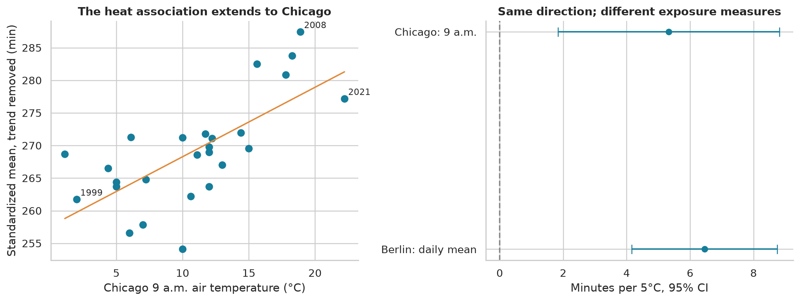

# Marathon performance modeling

An observational statistics project exploring how weather, demographics, pacing, training, and previous performance relate to marathon outcomes. Six real-world Kaggle datasets support complementary analyses of Berlin, Chicago, Boston, and U.S. fall marathons.

**Group 9 — Going for the Gold · UTRGV course project**

## Explore the project

- **[Executed Jupyter notebook](marathon_analysis.ipynb)** — 77 cells, 15 chapters, and 17 figures, with saved results. GitHub can display the notebook without running it.
- **[Statistical story](marathon_story.html)** — an integrated report with embedded charts. Download the HTML file and open it in a browser; GitHub displays its source.
- **[Figures and tables](outputs/)** — standalone charts, aggregate CSV tables, and calculated JSON results.
- **[Data sources and attribution](docs/DATA_SOURCES.md)** — versions, licenses as listed, exclusions, and overlap between sources.
- **[Supplementary analyses](docs/SUPPLEMENTARY.md)** — gap trends, a one-scale factor comparison, published-research comparison, and weather discussion; `make supplementary` runs them without raw data.

The [Berlin-only report](berlin_story.html) preserves the initial study. The integrated report contains the broader findings.

## Findings

| Question | Result | Interpretation |
| --- | --- | --- |
| Does the heat association replicate? | A 5°C increase corresponds to about **6.5 additional minutes in Berlin** and **5.3 in Chicago** in adjusted annual averages. | Observational comparisons; Berlin uses daily mean temperature, Chicago uses 9 a.m. temperature. |
| Does previous performance help prediction? | Among 4,922 matched Boston repeaters, using the previous finish reduces MAE from **27.8 to 15.1 minutes** compared with demographics. | Future-year evaluation; identity matches are conservative but unverified. |
| Does current pace help? | First-10-km information reduces remaining-time MAE from **24.3 to 13.0 minutes** in held-out Boston 2017 results. | Information available after 10 km; this is not a pre-race forecast. |
| Do race fields differ? | The 90th–10th percentile spread of adjusted means remains **36.7 minutes** across 21 supported race fields. | Demographic adjustment does not isolate course difficulty from participant selection. |
| Do training logs help? | Training volume, frequency, and pace reduce cross-event proxy MAE from **56.8 to 21.8 minutes**. | The outcome is logged race-day duration, not certified finish time. |
| What about humidity, wind, and acclimatization? | Separate estimates are inconclusive. | Small annual samples and imperfect exposure proxies limit interpretation. |

MAE is mean absolute error, measured in minutes here. Model errors are comparable within each study's test population, not across different populations or outcomes.



## Reproduce the analysis

Use Python 3.12. Commands below assume a Unix shell and are run from the repository root.

```bash
git clone git@github.com:Venom-Ocelot/marathon-performance-modeling.git
cd marathon-performance-modeling
python3 -m venv .venv
.venv/bin/python -m pip install -r requirements.txt
```

The direct dependencies are pinned in `requirements.txt`. The complete original environment is recorded in `requirements-lock.txt` for reference.

### Read and check without downloading data

The executed notebook, reports, aggregate results, and figures are committed. No credentials are needed to read them or run the lightweight checks:

```bash
make check
```

GitHub Actions runs these artifact checks. It does **not** download Kaggle data or re-run the full analysis.

### Download the original inputs

Configure Kaggle credentials outside the repository using `KAGGLE_API_TOKEN`, `~/.kaggle/access_token`, or legacy `~/.kaggle/kaggle.json`. The downloaders also support `KAGGLE_CONFIG_DIR` and legacy credential environment variables.

```bash
make download
```

Downloads use pinned dataset versions and verify the committed SHA-256 manifests. Raw inputs are intentionally excluded from Git. Allow roughly 2 GB of disk space for data and archives, plus the Python environment; the daily training CSV alone is about 956 MB. Dataset availability and access remain subject to Kaggle and the source authors.

### Execute and verify

```bash
make notebook   # Open JupyterLab; choose Restart Kernel and Run All Cells
# Or run without a browser:
make execute
make validate   # Independently reconstruct key calculations from raw inputs
```

The notebook executes offline once dependencies and data are installed. Allow several GB of available memory. Execution regenerates both reports and all analysis outputs.

To regenerate only the reports from the committed results:

```bash
make reports
```

Run `make help` for the available commands. Windows users can run the underlying Python scripts with their environment's interpreter; the Makefile uses Unix-style paths.

## Repository layout

```text
marathon_analysis.ipynb     Executed analysis and explanations
marathon_story.html        Integrated standalone report
berlin_story.html          Initial Berlin study
scripts/                   Downloads, notebook generators, reports, checks
outputs/                   Berlin figures, tables, and calculated results
  expanded/                Additional event, pacing, and training analyses
data/
  catalog/                 Kaggle source metadata and candidate descriptions
  raw/                     Tracked manifests; downloaded inputs stay local
docs/                      Source attribution and analysis guide
.github/workflows/         Artifact checks without private credentials
```

## Methods and scope

Weather inference uses race years as observations, with demographic standardization, calendar trends, robust uncertainty estimates, and sensitivity checks. Prediction models hold out later years or different events and distinguish pre-race information from checkpoints. ZIP joins, split arithmetic, conflicting bib records, and conservative runner linkage are audited explicitly.

The original Berlin tests use Holm adjustment. The extensions are exploratory; four focal weather tests use false-discovery-rate adjustment. Training-log results remain supplementary because their outcome is a recording proxy. The [analysis guide](docs/ANALYSIS.md) explains the chapter sequence and important limitations.

Source record counts must not be added into a unique-person total: Chicago overlaps the fall-marathon sample, and runners recur across races. The repository publishes aggregate results rather than raw names, ZIP codes, or the original classroom discussion.

## Editing and attribution

The notebook's source is generated by `scripts/build_notebook.py`, `scripts/extension_cells.py`, and `scripts/training_cells.py`. For reproducible source edits, modify those files and run `make rebuild-notebook`, then `make execute` and `make validate`. Rebuilding overwrites manual notebook edits and saved outputs.

Dataset licenses differ and are documented individually in [Data sources](docs/DATA_SOURCES.md). Their terms are not replaced by a blanket project license. No project-wide reuse license has been assigned to the original code and prose.
