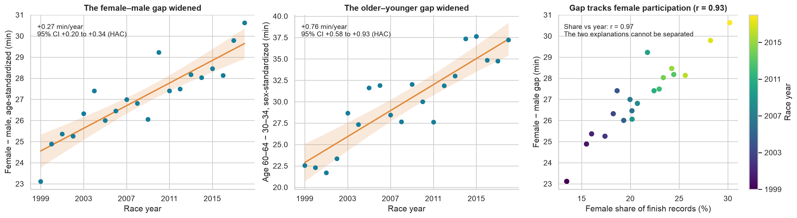
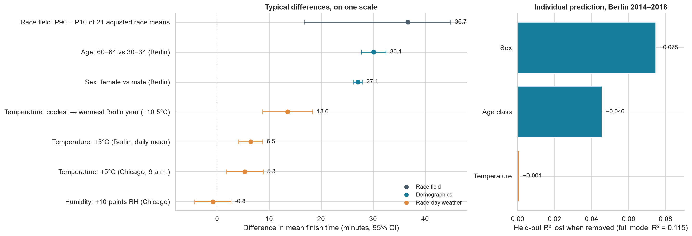
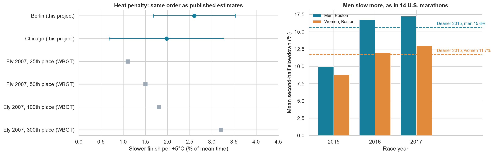
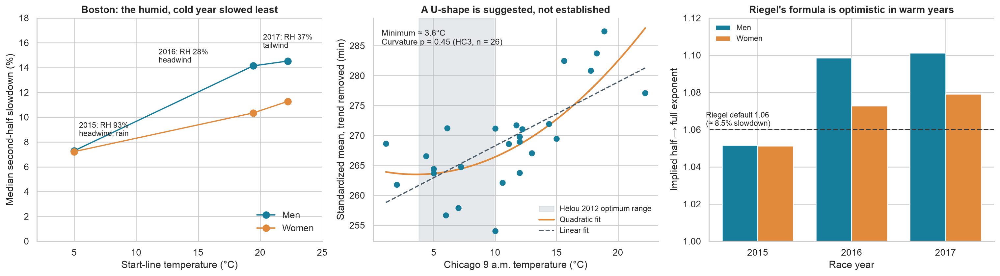

# Supplementary analyses

These four analyses use only committed aggregate outputs, so they run without Kaggle credentials or raw data:

```bash
make supplementary
```

Results are in [`outputs/supplementary/`](../outputs/supplementary/): four figures, six tables, and `results.json`. Annual trend tests use lag-1 HAC standard errors, as in the Berlin sensitivity analysis; Chicago models use HC3 errors, as in Chapter 9. All analyses are exploratory and observational.

## 1. The demographic gaps widened over time



The primary Berlin test reports the 1999–2018 average of 20 annual contrasts. Those contrasts are not stable. The age-standardized female-minus-male gap rose from 23.1 minutes in 1999 to 30.6 minutes in 2018, a trend of **+0.27 minutes per year (95% CI 0.20–0.34)**. In relative terms, it rose 0.10 percentage points of the male mean per year (0.08–0.13), so the widening is not just a consequence of all runners slowing down. The sex-standardized gap between ages 60–64 and 30–34 also widened, by **+0.76 minutes per year (0.58–0.93)**.

Over the same period, the female share of finish records rose from 13.5% to 30.2%. One plausible explanation is broader participation: as more recreational women and older runners entered, those groups became less selected. In a joint model, the female share remains associated with the gap (0.49 minutes per percentage point, 0.29–0.69) while the year term is near zero. However, female share and year are almost collinear (r = 0.97, variance inflation factor 17.7), so these 20 years cannot separate participation from other time trends. We present participation as a hypothesis. The 27.1-minute primary estimate should be read as a period average, not a constant.

## 2. Which factors have the strongest associations?



The left panel puts the main estimates on one scale: minutes of mean finish time. Differences between race fields are largest (36.7 minutes between the 90th and 10th percentile of 21 demographically adjusted race means; bootstrap 95% CI 16.8–44.9). They are followed by age (30.1 minutes, 60–64 vs 30–34) and recorded sex (27.1 minutes). A 5°C warmer race day is associated with 5–6.5 additional minutes. Across Berlin's coolest and warmest race days (+10.5°C), that is 13.6 minutes (8.7–18.4). Humidity has no clear association (−0.8 minutes per 10 RH points, −4.3 to 2.7).

The right panel shows individual-level prediction for held-out Berlin years 2014–2018. Removing sex costs the most explained variance (R² falls by 0.075), followed by age class (0.046); removing temperature changes R² by only 0.001. Weather moves the whole field on a given day, but it explains little of the difference between two runners in the same race.

These quantities compare different units: race fields, demographic groups, and annual means. They describe the magnitude of typical differences, not a causal ranking. Even the full demographic model explains only 11.5% of individual variation.

## 3. Comparison with published research



**Heat.** [Ely et al. (2007)](https://pubmed.ncbi.nlm.nih.gov/17473775/) studied seven marathons and found that performance slows progressively as wet-bulb globe temperature (WBGT) rises from 5 to 25°C. Per 5°C of WBGT, the 25th-, 50th-, 100th-, and 300th-place finishers slowed by about 1.1%, 1.5%, 1.8%, and 3.2%; slower runners were affected more. Our whole-field estimates are 2.6% (1.7–3.5) per 5°C in Berlin and 2.0% (0.7–3.3) in Chicago, the same order of magnitude. Because WBGT combines temperature, humidity, and radiation, this comparison is approximate.

**Humidity and the optimal temperature.** [Helou et al. (2012)](https://journals.plos.org/plosone/article?id=10.1371%2Fjournal.pone.0037407) analyzed 1,791,972 performances at six major marathons, including Berlin, Boston, and Chicago, from 2001 to 2010. Air temperature was the dominant environmental factor; humidity, dew point, and atmospheric pressure had no significant effect. Speed followed a quadratic relationship with temperature, with optima between 3.8 and 9.9°C depending on performance level. This is consistent with our inconclusive Chicago humidity estimate.

**Pacing by sex.** [Deaner et al. (2015)](https://pmc.ncbi.nlm.nih.gov/articles/PMC4289124/) analyzed 91,929 performances at 14 U.S. marathons in 2011. Men slowed by 15.6% in the second half on average and women by 11.7%. Boston men in 2016 and 2017 slowed by 16.8% and 17.3%; women slowed by 12.0% and 13.0%. In cool 2015, both slowed less (9.9% and 8.8%).

## 4. Weather: what the inconclusive results still show



**Humidity needs heat.** Boston start-line conditions provide an illustration, not a test. In 2015 it was 5°C with 93% humidity, rain, and a headwind; the median second-half slowdown was about 7%. In 2016 (19°C, 28% humidity) and 2017 (22°C, 37% humidity), median slowdown rose to 10–15%. The most humid year produced the least slowing, which fits the view that humidity matters mainly when combined with heat. With three race days, this is descriptive. Weather values come from [Find My Marathon](https://www.findmymarathon.com/weather-detail.php?year=&zname=Boston+Marathon) and contemporary reports; Boston runs west to east, so easterly wind is a headwind.

**A possible optimal temperature.** Adding a squared temperature term to the Chicago model gives a U-shaped curve with a minimum near 3.6°C, close to the lower end of Helou's optimum. The curvature is not statistically significant (p = 0.45, HC3, 26 race years; p = 0.06 when the interrupted 2007 race is included). Berlin cannot test this because its race-day temperatures range only from 8.9 to 19.4°C.

**Riegel's formula in warm weather.** Riegel's race-time formula, with its usual exponent of 1.06, implies that the second half takes about 8.5% longer than the first. Boston medians in cool 2015 imply exponents of 1.05, close to that assumption. Warm 2016 and 2017 imply 1.07–1.10. For a 4-hour male finisher in 2016–2017, predicting the finish from the half split with Riegel's exponent underestimates the time by about 6–7 minutes. Boston's hilly second half is the same each year, so the year-to-year difference is consistent with the weather, although other year-specific factors cannot be excluded.
